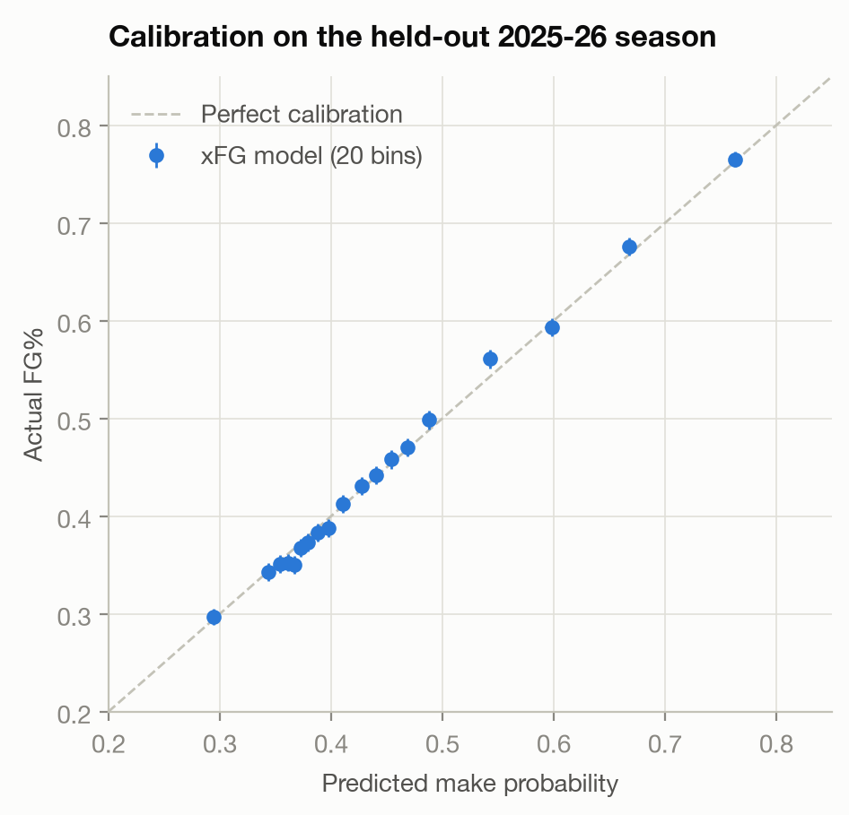
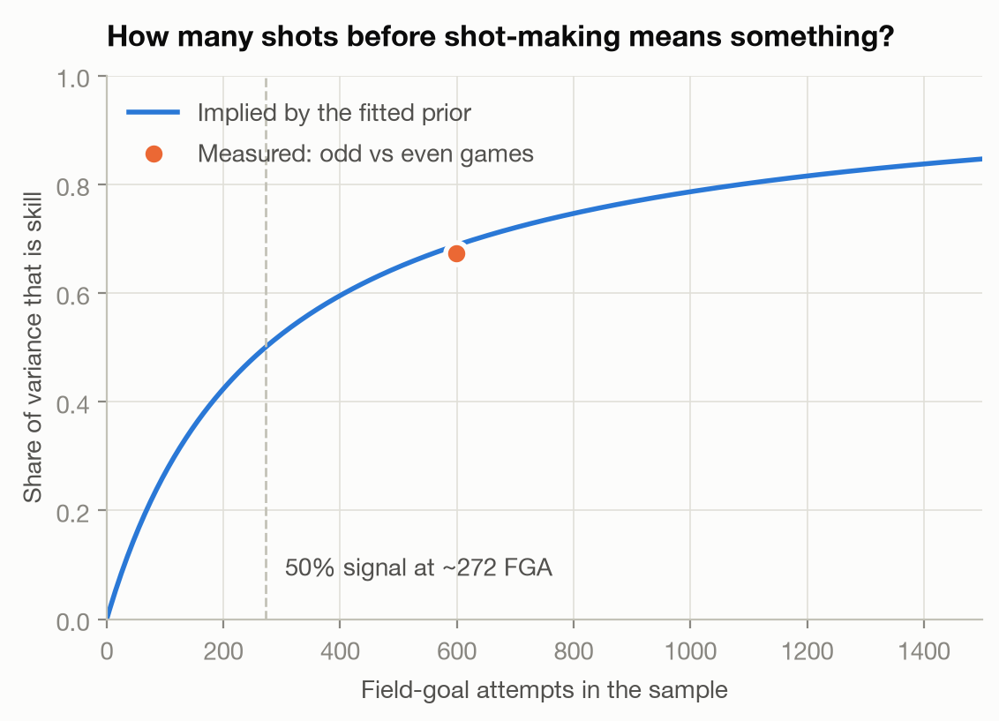
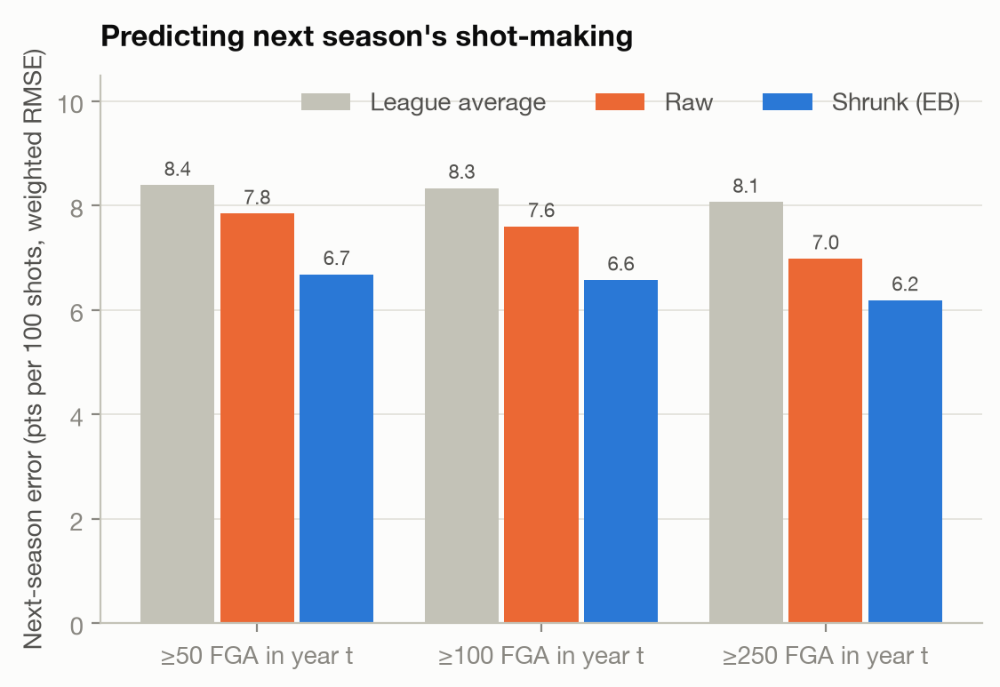
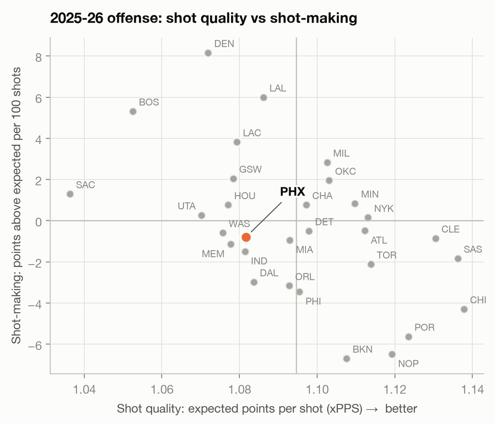
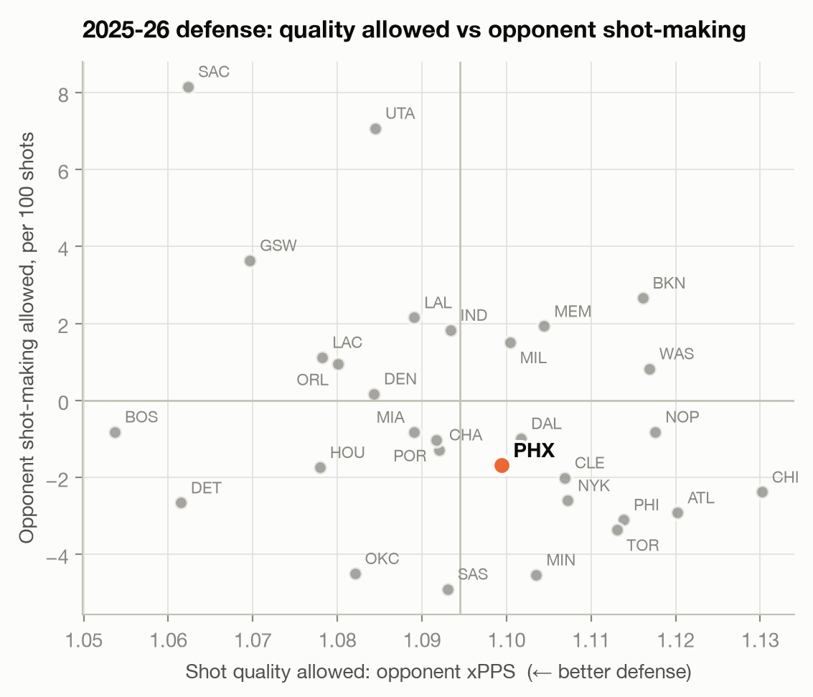
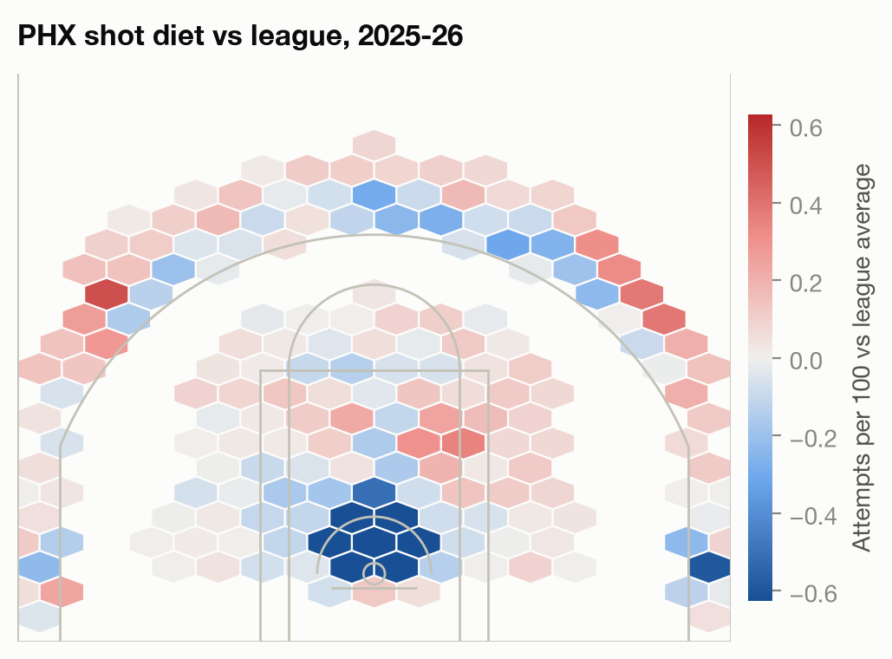
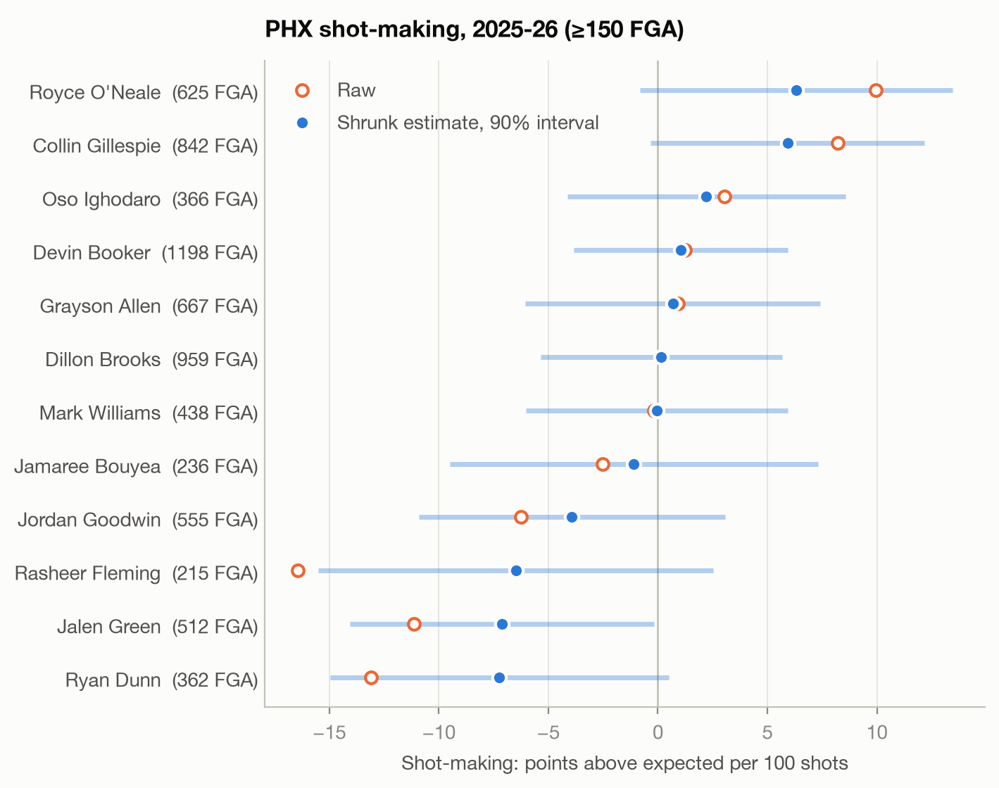

# Shot Quality vs. Shot-Making

**Separating the shots a team *gets* from the shots it *makes*, with honest uncertainty.**

An expected-field-goal (xFG) model scores every NBA field-goal attempt from 2022-23 through
2025-26 (874,606 shots, 4,920 games). From it, each player's and team's offense splits into
two parts:

- **Shot quality**: expected points per shot (xPPS), driven by shot selection and scheme.
- **Shot-making**: points scored above expectation, estimated with empirical-Bayes shrinkage
  so that small samples are not mistaken for skill.

The point is decision support. Which part of a team's offense or defense will persist? How
many shots before a player's shot-making means something? What does a change in shot diet
buy? A [Phoenix Suns case study](docs/suns_memo.md) applies all of it.

## Key findings

| Question | Answer |
|---|---|
| Does a location + context model beat the zone averages used in most shot charts? | **Yes.** On a fully held-out 2025-26 season: log loss 0.640 vs 0.657, AUC 0.659 vs 0.637, and calibrated to within 2 percentage points in every probability bin. |
| How many attempts before shot-making is half signal, half noise? | **~272 FGA** overall; **~139 twos** but **~330 threes**. |
| Is the shrinkage prior right? | An independent odd/even-game split gives a measured reliability of **0.67** at the median sample; the prior predicts **0.69**. |
| Does shrinkage predict next season better than the raw number? | **Yes: 12–15% lower error** at every sample-size cutoff (1,030 player-season pairs). |
| What should a team defense be judged on? | **The shots it allows.** First-half vs second-half correlation is r = 0.75 for shot quality allowed but only 0.48 for opponent shot-making. |
| Suns, 2025-26 | 20th in shot quality. Bottom-six in rim-attempt share **four straight seasons**. Shifting 5% of attempts from mid-range and floaters to the rim is worth **≈ +2.5 points per 100 shots (≈ +2.3 per game)**. |

## 1. The xFG model

A gradient-boosted classifier (scikit-learn `HistGradientBoostingClassifier`) predicts make
probability. It uses court location (x, y, distance, angle, 2 vs 3) plus shot context: shot
family (catch-and-shoot jumper, pull-up, step-back, floater, layup, dunk, putback, ...),
period, clock, end-of-period heaves, and home/away.

**Validation is time-based.** The model trains on 2022-23 through 2024-25 and is tested on
the entire 2025-26 season, which it never saw:

| Model | Log loss | Brier | AUC |
|---|---|---|---|
| League average | 0.6915 | 0.2492 | 0.500 |
| Zone average (NBA shot-chart zones) | 0.6570 | 0.2321 | 0.637 |
| GBM: location only | 0.6490 | 0.2288 | 0.650 |
| **GBM: location + context** | **0.6401** | **0.2253** | **0.659** |



For all player and team analysis, every shot is scored **out-of-season**: a model trained on
the other three seasons predicts each season. No player-season is graded by a model that
saw it.

## 2. Shot-making, sample size, and shrinkage

A player's raw shot-making is points above expected per shot: `value × (made − xFG)`. Raw
numbers over a few hundred shots are mostly noise. The model treats each player's true skill
as drawn from a league-wide distribution. Its spread (τ ≈ 7.1 points per 100 shots) is
estimated by the method of moments, after subtracting the binomial noise implied by *each
player's own shot difficulty*. Every estimate is pulled toward the league mean in
proportion to its noise and gets a 90% interval.



The fitted prior implies how reliable an estimate should be at any sample size. An
independent check that never touches the prior (odd vs even games, Spearman-Brown corrected)
lands on the curve.

**Backtest.** Year *t* shot-making is used to predict the same player's year *t+1*, weighted
by year-*t+1* attempts:



| Year-t sample | Pairs | League avg | Raw | **Shrunk** |
|---|---|---|---|---|
| ≥ 50 FGA | 1,030 | 8.4 | 7.8 | **6.7** |
| ≥ 100 FGA | 981 | 8.3 | 7.6 | **6.6** |
| ≥ 250 FGA | 794 | 8.1 | 7.0 | **6.2** |

*(weighted RMSE, points per 100 shots)*

## 3. Teams: what persists?

Each team-season is split into first and second halves and the halves are correlated
(120 team-seasons):

| | Points per shot | Shot quality (xPPS) | Shot-making |
|---|---|---|---|
| Offense | 0.66 | **0.76** | 0.68 |
| Defense | 0.44 | **0.75** | 0.48 |

Offense keeps much of its shot-making, since rosters carry real shooting talent. On
defense, opponents' shot-making above expectation is far less repeatable than the quality
of shots allowed. The practical rule: **evaluate a defense on the xPPS it allows**, and
expect opponent shot-making to regress.

<p>


</p>

## 4. Case study: Phoenix Suns, 2025-26

Full write-up in **[docs/suns_memo.md](docs/suns_memo.md)**. In short:

- **The offense's problem is shot quality, not shot-making.** PHX ranked 20th in xPPS
  (1.082) and 17th in shot-making (−0.8 per 100).
- **The rim is missing.** 23.4% of attempts came at the rim vs a 28.1% league median, 28th
  in the NBA, after 30th, 25th and 30th the prior three seasons. That consistency makes it an
  organizational pattern, not one roster's quirk.
- **The defense was a bit fortunate.** It ranked 17th in xPPS allowed and 12th in opponent
  shot-making, the part that tends to regress.

<p>


</p>

## 5. Interactive explorer

A Streamlit app over the pipeline's outputs, for any team and season:

- **Team:** quality vs making quadrants with tooltips, the zone diet, and the shot-diet hex
  map.
- **Players:** raw vs shrunk shot-making, 90% intervals, the "signal share" of each
  estimate, and a shot chart colored by xFG.
- **Shot-diet what-if:** move attempts between zones and see the change in xPPS and points
  per game.

```bash
streamlit run app/streamlit_app.py
```

## Reproduce

```bash
python -m venv .venv && source .venv/bin/activate
pip install -e ".[app,dev]"
python scripts/run_pipeline.py          # downloads data, fits models, writes artifacts/ and docs/
pytest                                  # 17 tests
```

The pipeline takes about two minutes on a laptop. Data comes from the public
[`shufinskiy/nba_data`](https://github.com/shufinskiy/nba_data) mirror of stats.nba.com
`ShotChartDetail`. Every regular-season FGA is included, with location, shot type, clock,
and result. `--team XXX` reruns the case study for any team.

## Limitations, and what I'd do with team data

- **No defender or tracking information.** The biggest missing input is
  closest-defender distance, plus shooter speed, touch time and dribbles. With tracking data,
  "shot quality" would separate a contested pull-up from an open one, and xFG would sharpen
  considerably beyond this model's AUC of 0.66.
- **Shot family is a human-coded proxy and partly a player choice.** Conditioning on it means
  a step-back-heavy player is not "charged" in shot-making for choosing step-backs. That cost
  shows up in xPPS instead, which is intended, but it is a modeling choice.
- **Field goals only.** Free throws, and-ones and shooting fouls are excluded. Rim attempts
  draw the most fouls, so this *understates* the value of the rim and the Suns
  recommendation is conservative.
- **One prior for everyone.** The natural next step is a hierarchical model with priors that
  depend on role, position, shot type, and the player's own prior seasons. Several Suns
  players show consistent multi-year signals that a single-season view under-uses.
- **The what-if prices selection, not feasibility.** It assumes the added attempts are as
  good as the team's current ones in that zone. Defenses adapt, and rim access depends on
  personnel.

## Layout

```
src/shotquality/
  data.py        download, clean, team/opponent resolution, shot families
  model.py       xFG models, zone baseline, evaluation, calibration, out-of-season scoring
  shrinkage.py   empirical-Bayes shot-making, stabilization point, split-half reliability
  analysis.py    backtests, half-season stability, team tables, zone profiles, what-if
  plots.py       figures (court drawing, quadrants, hex maps, interval plots)
scripts/run_pipeline.py   end-to-end run -> artifacts/ (metrics.json, CSVs, scored shots) + docs/
app/streamlit_app.py      interactive explorer
tests/                    synthetic-data tests (shrinkage recovers known skill, etc.) + app smoke test
```
